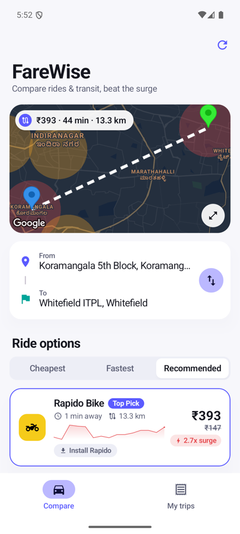
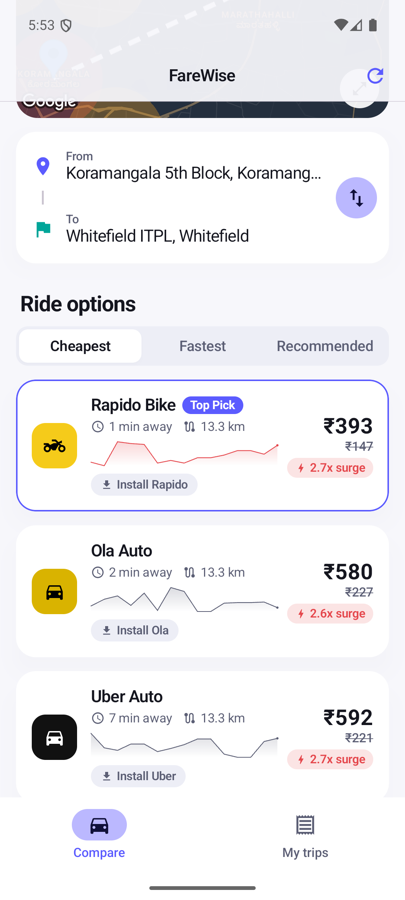
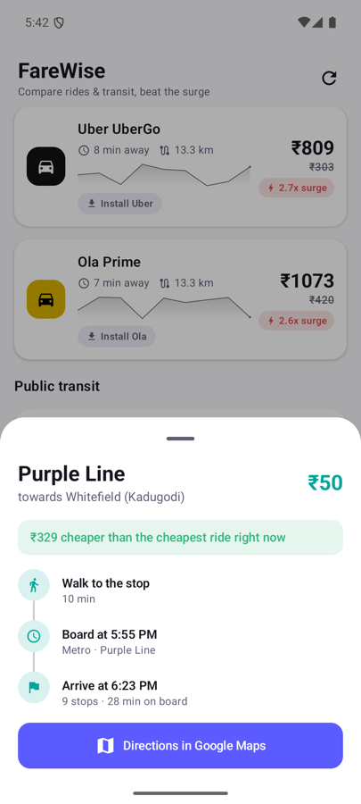
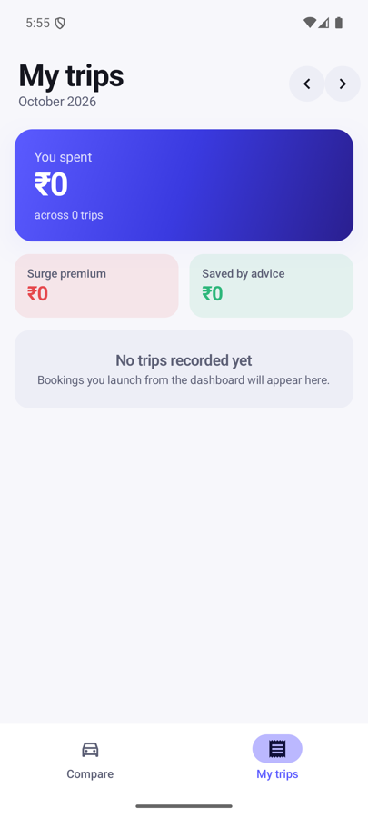
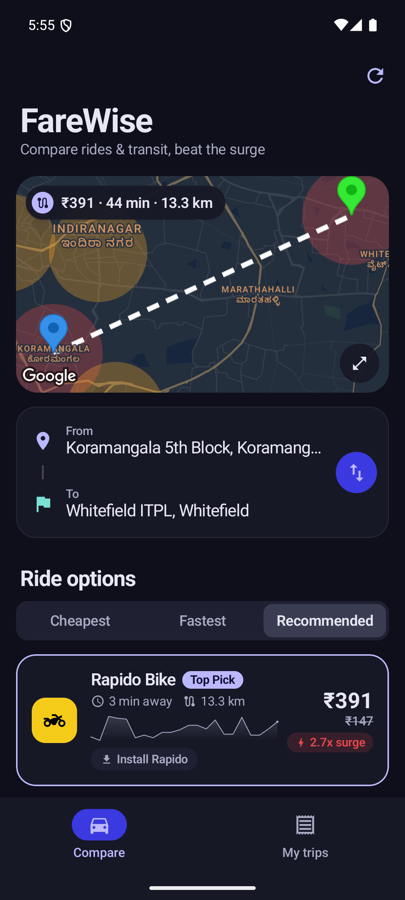

# FareWise

**Compare rides and public transit on one screen, and know whether to book now or wait out the surge.**

FareWise is an Android app for Bengaluru commuters. It puts Uber, Ola and Rapido quotes next to Metro, BMTC bus and suburban rail options. Two on-device machine-learning models forecast where surge prices are heading. When a big drop is coming, the app tells you to wait; when prices are about to climb, it tells you to book now.

<p align="center">
  
  
  
  
  
</p>

## Features

- **Unified comparison.** All ride tiers (bike, auto, hatchback, sedan, premium) and transit departures in one list, ranked by *Cheapest*, *Fastest* or *Recommended*. Recommended weighs price, door-to-door time and surge.
- **Surge forecasting.** An LSTM model predicts the next 30 minutes of prices from the last 2 hours, and a decision engine turns that into a single "wait" or "book now" banner.
- **Fare confidence bands.** An MLP fare estimator puts a ± range on every quote.
- **Live routing.** Real driving distance, traffic delay and road geometry come from the Google Maps Routes API.
- **Multimodal combos.** Metro or bus plus a last-mile ride, when that combination beats a cab.
- **One-tap booking.** Deep links open the partner app with pickup and drop already filled in, or the Play Store if the app isn't installed.
- **Trip journal.** Monthly spend, surge premium paid, and money saved by following the advice.
- **Crafted motion.** Cards scale on press with haptics, the segmented control's thumb slides on a spring, prices roll digit by digit (tinted red or green by direction), the large title collapses iOS-style, and lists cascade in on first load. Custom easing curves keep all of this under 300 ms.
- Pull-to-refresh, loading skeletons, a full-screen map, transit detail sheets with Google Maps hand-off, and light and dark themes.

## Tech stack

| Layer | Tools |
| --- | --- |
| UI | Kotlin, Jetpack Compose, Material 3, Navigation Compose, Maps Compose |
| Architecture | MVVM, clean architecture (domain / data / ui), Hilt DI, Kotlin Flows |
| Data | Room, DataStore, Retrofit + Moshi, OkHttp |
| Background | WorkManager (15-minute surge-prediction job) |
| ML | TensorFlow Lite on device; training in Python / TensorFlow (`ml_model/`) |
| APIs | Google Maps SDK + Routes API, OpenWeatherMap (optional) |

## Project structure

```
app/src/main/java/com/farewise/app/
├── data/        # repositories, Room DB, Retrofit services, TFLite models, WorkManager
├── domain/      # models, repository interfaces, use cases (ranking, surge decisions)
├── di/          # Hilt modules
└── ui/          # Compose screens: dashboard, trip journal, theme, navigation
ml_model/        # training scripts + Colab notebooks for both TFLite models
```

## Getting started

1. Open the project in **Android Studio** (a recent stable version with AGP 9 support).
2. Copy `local.properties.example` to `local.properties` and fill in:
   - `sdk.dir`: your Android SDK path. Android Studio usually sets this for you.
   - `GOOGLE_MAPS_API_KEY`: a key with **Maps SDK for Android** and **Routes API** enabled.
   - `OPEN_WEATHER_API_KEY` (optional).
3. Run the `app` configuration on a device or emulator (Android 7.0+).

The app still works without API keys. Prices and routes fall back to built-in estimates, and the map draws a straight line instead of the road route.

```bash
./gradlew assembleDebug        # build
./gradlew testDebugUnitTest    # unit tests
./gradlew lintDebug            # lint
```

## Retraining the models

See [`ml_model/README.md`](ml_model/README.md). Both models train in a couple of minutes on a CPU or in Google Colab. They export a `.tflite` file plus a metadata JSON into `app/src/main/assets/`.

## Note on pricing data

Uber, Ola and Rapido don't offer public pricing APIs. FareWise therefore combines real route data from Google (distance, live traffic, free-flow time) with each provider's published fare structure to estimate quotes. Treat the quotes as estimates, not live prices.
